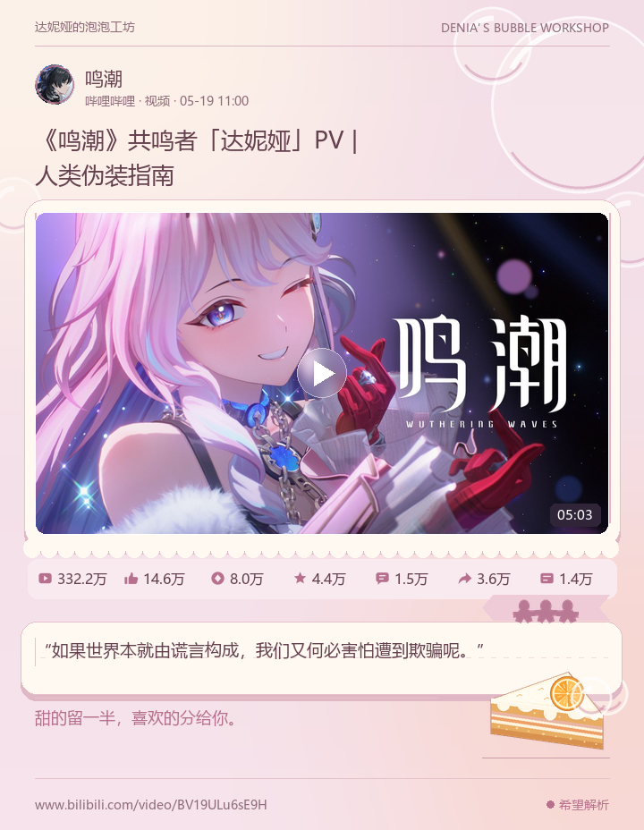

# Denia Share Themes

收纳独立维护、按需安装的插件管理界面。插件本体只携带经典界面，自设界面的模板、样式、角色图片和装饰放在本仓库。

仓库包含主题源码。本地构建的 ZIP 可直接导入插件。主题尚未发布下载包时，`catalog.json` 中对应的下载地址为空。

## 已有界面

| 目录 | 名称 | 适配插件 |
| --- | --- | --- |
| `themes/denia` | 达妮娅的泡泡工坊 | `astrbot_plugin_denia_share` |
| `themes/lily` | 莉莉的梦境花园 | `astrbot_plugin_denia_share` |

每个界面独立存放 `theme.json` 和 `webui/`。泡泡工坊复用宿主插件提供的经典业务组件与共享图标；这些依赖由插件提供，不复制进主题包。安装后仍调用插件的真实解析、账号、配置、卡片预览与下载接口。

## 标准卡片预览

点击卡片打开对应的官方 PV。

| 达妮娅的泡泡工坊 | 莉莉的梦境花园 |
| :---: | :---: |
|  |  |

## 本地构建与安装

运行 `python build.py denia`，生成 `dist/denia-webui-1.2.0.zip` 和 SHA-256 校验文件。ZIP 根目录包含 `theme.json`、`webui/` 和许可文件 `LICENSE.txt`，不套仓库目录。

在插件经典界面的「配置 → 自设 WebUI」中导入该 ZIP；安装成功后，再将「WebUI 样式」切换为「达妮娅的泡泡工坊」并保存。尚未安装或资源加载失败时会使用经典界面，`?ui=classic` 始终可作临时恢复入口。

以后发布远端主题包时，可在同一安装入口填写该 ZIP 的 HTTPS 直链与可选的 SHA-256，下载、校验后安装。不能直接使用整个 Git 仓库的源码 ZIP 替代单独的主题包。

## 卡片与界面（1.2.0）

「卡片工坊」调用插件后端实时渲染，可选择标准、杂志、沉浸、信息流四种布局。预览与聊天发送使用同一渲染器，不携带静态卡片样稿。

卡片皮肤取决于插件已保存的「WebUI 样式」。泡泡工坊使用达妮娅皮肤，莉莉的梦境花园使用莉莉皮肤，经典界面使用经典皮肤。卡片的深浅配色与布局独立设置，网页切换明暗不会改变卡片配置。通过 `?ui=classic` 临时恢复经典页面也不会改变已保存的选择。

莉莉的梦境花园 **1.2.1** 提供「白纱」与「黑纱」两套卡片形态。百合、香水瓶与薄纱贯穿卡面。白纱采用紫色云雾，黑纱采用牵牛花形的梦境花。运行 `python build.py lily` 构建主题，用包含新版莉莉渲染器的希望解析器工作区版本导入 `dist/lily-webui-1.2.1.zip`。进入卡片工坊选择形态并保存后，聊天分享也会使用该形态。

达妮娅专属卡片素材也包含在主题包内，与界面一起安装并保存在插件数据目录。插件本体不再携带这些图片；更新插件后可继续使用已安装素材，未安装或素材缺失时由渲染器绘制基础图形。所有卡片共用的 emoji 字体和平台图标仍由插件提供。

## 安装后的文件

插件数据目录中的 `webui_themes/` 保存已安装主题，插件页面目录中的 `studio/` 是运行时副本。插件更新后可从数据目录恢复，不需要每次联网。运行时副本不进入插件 Git 或发布包。

旧版插件已有内置 `studio/` 时，首次安装仅会接管与安装包逐文件完全一致的目录；若里面有手工修改或额外文件，会保留原目录并拒绝覆盖，可先备份并移开后再安装。

## 添加其他自设界面

在 `themes/<id>/` 中添加独立描述文件和 `webui/`，声明目标插件、界面 API 版本、入口及挂载目录；界面的业务 API 必须与目标插件兼容。不能覆盖经典界面或共享文件。其他界面需要目标插件提供对应的样式选择支持；放入目录不代表已经自动兼容。

卡片的布局和明暗属于插件渲染器功能。本仓库只拆出 WebUI 资源，不把尚未接入的卡片设计样稿当成可安装功能。

## 来源与许可

页面代码从当前插件工作区的泡泡工坊版本完整迁出；经典组件和共享图标仍保留在插件。代码沿用仓库 `LICENSE` 的 MIT 许可。达妮娅角色相关图片与名称涉及原角色权利，MIT 代码许可不代表对角色素材的权利授权；图片为此前本地设计流程生成并压缩的界面素材，不包含游戏原始模型。
