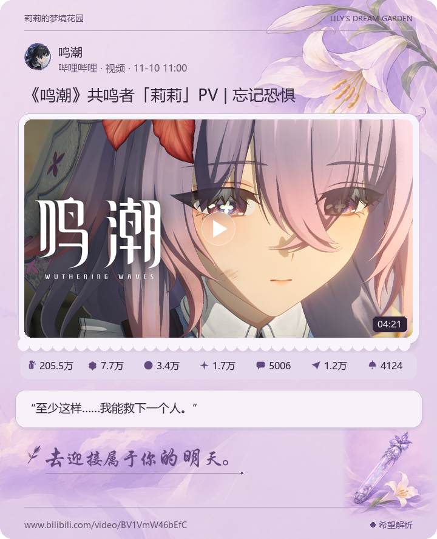
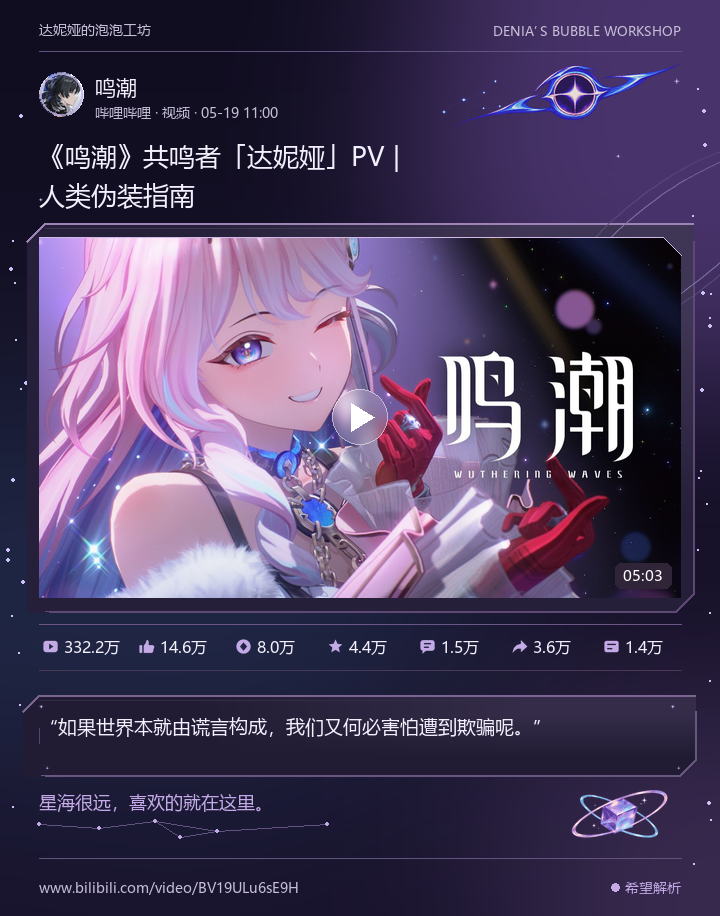
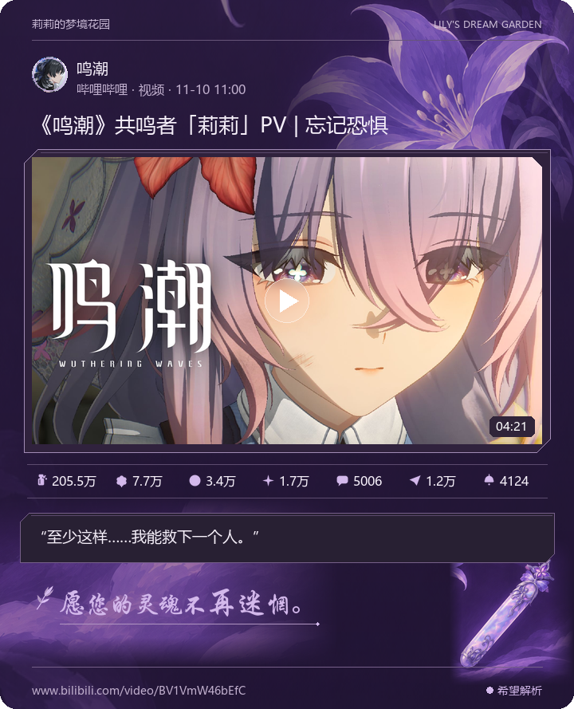

# 达妮娅分享主题库

这是给「希望解析器」换样子的主题库。装上主题后，插件页面和聊天里的分享卡片都会换成你选的样子。

## 先看看长什么样

点一下卡片，就能打开对应的《鸣潮》官方视频。

| 达妮娅的泡泡工坊 | 莉莉的梦境花园 |
| :---: | :---: |
|  |  |
|  |  |

## 莉莉的调香台

白纱下，莉莉在温室里写手记。切换到黑纱，就能看见她在月光下举起香水瓶。桌面首页并排放置链接输入框和分享预览，手机上按操作顺序纵向排列。首页可以查看《忘记恐惧》的莉莉样张，也可以用插件当前配置试渲染。

[白纱调香台](docs/images/lily-webui-day.webp) · [黑纱调香台](docs/images/lily-webui-night.webp) · [手机界面](docs/images/lily-webui-mobile-day.webp) · [调香手记](docs/images/lily-webui-journal.webp)

「调香手记」收录四篇按莉莉角色档案和语音整理的短文，每篇标注出处。两幅温室题图是参考莉莉立绘创作的主题插画。

## 怎么装

先在 AstrBot 里装好希望解析器。要显示上图中的达妮娅法杖、星环和莉莉香水瓶布局，需搭配支持这套重绘素材的插件版本。[希望解析器](https://github.com/xiaoxi2760/astrbot_plugin_denia_share)

### 第一步 · 拿到主题包

在[主题发布页](https://github.com/xiaoxi2760/denia-share-themes/releases/tag/themes-2026-11-20)下载对应角色的 ZIP，直接看第二步。如果想从源码构建，可使用下列命令。

1. 在这个仓库页面点绿色的 **Code** 按钮，再点 **Download ZIP**。
2. 把下载的文件解压。打开解压后的文件夹，在里面打开终端。终端就是输入命令的窗口。这一步需要电脑上装好 Python。
3. 选一个主题，把对应的命令复制到终端，按回车。

| 我想装 | 输入这条命令 |
| --- | --- |
| 达妮娅的泡泡工坊 | `python build.py denia` |
| 莉莉的梦境花园 | `python build.py lily` |

命令跑完后，打开 `dist` 文件夹。里面名字以 `.zip` 结尾的文件就是刚做好的主题包。

### 第二步 · 装进希望解析器

1. 打开希望解析器的页面，进入它的经典界面。
2. 点「配置」，找到「自设 WebUI」。选中刚才的主题包，点「导入安装包」。
3. 找到「WebUI 样式」，选你刚装的主题，然后点保存。

## 怎么换卡片的样子

在达妮娅主题打开「卡片工坊」，在莉莉主题打开「卡片装帧」。选好排版和颜色，再点保存。莉莉可以选白纱或黑纱。聊天里发出的新卡片会用你保存的样子。

如果主题页面打不开，可以在页面网址后面加上 `?ui=classic`，先回到经典界面。

## 图片和代码

两张卡片里的视频封面来自《鸣潮》官方 PV。游戏角色和官方图片的权利属于原权利人。仓库代码按 MIT 许可证提供。[查看许可证](LICENSE)
